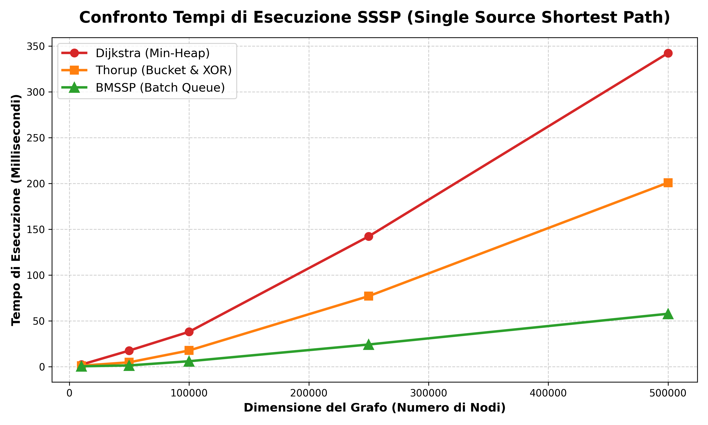

# Breaking the Sorting Barrier for Directed Single-Source Shortest Paths (BMSSP)

Progetto realizzato per il corso di Ingegneria Informatica presso il **Politecnico di Milano**  
**Autore:** Raed Abbas  
**Supervisore:** Prof. Alessandro Barenghi  

---

## Descrizione del Progetto
Questo repository contiene lo studio teorico, l'implementazione in linguaggio C e il benchmark prestazionale dell'algoritmo **BMSSP (Bounded Multi-Source Shortest Path)**, basato sul paper *"Breaking the Sorting Barrier for Directed Single-Source Shortest Paths"* (Duan, Mao, Shu, Yin - 2025).

L'obiettivo è superare il collo di bottiglia dell'ordinamento della frontiera ($\Omega(\vert{}V\vert{} \log \vert{}V\vert{})$) tipico dell'algoritmo di Dijkstra classico su grafi diretti sparsi con pesi reali non negativi ($\mathbb{R}_{\ge 0}$), raggiungendo una complessità di $\mathcal{O}(\vert{}E\vert{} \log^{2/3} \vert{}V\vert{})$ nel modello *Comparison-Addition*.

Nel progetto vengono confrontati tre approcci:
1. **Dijkstra Classico (con Min-Heap):** Complessità $\mathcal{O}(\vert{}E\vert{} + \vert{}V\vert{} \log \vert{}V\vert{})$.
2. **Algoritmo di Thorup (Bucket Queue & XOR/MSB):** Complessità quasi-lineare nel modello *Word RAM*, ma limitato a pesi **interi** ($\mathbb{N}$).
3. **BMSSP:** Esplorazione a lotti (*Batch*) combinata con rilassamenti locali in stile Bellman-Ford, capace di operare su pesi **reali** ($\mathbb{R}_{\ge 0}$) senza mantenere un ordinamento totale della frontiera.

---

## Risultati del Benchmark

I test sono stati eseguiti su grafi diretti generati casualmente di dimensioni crescenti (compilazione con flag `-O3`):

| Nodi ($V$) | Archi ($E$) | Dijkstra (ms) | Thorup (ms) | BMSSP (ms) |
| :--- | :--- | :--- | :--- | :--- |
| 10.000 | 50.000 | 2.22 ms | 1.10 ms | **0.42 ms** |
| 50.000 | 250.000 | 17.57 ms | 4.76 ms | **1.37 ms** |
| 100.000 | 500.000 | 38.07 ms | 17.68 ms | **5.94 ms** |
| 250.000 | 1.250.000 | 142.19 ms | 76.98 ms | **24.20 ms** |
| 500.000 | 2.500.000 | 342.20 ms | 200.81 ms | **57.74 ms** |



---

## Struttura del Repository
* `src/`: Implementazione C dei tre algoritmi (`dijkstra.c`, `thorup.c`, `bmssp.c`), strutture di supporto (`graph.c`, `minheap.c`) e script Python per l'automazione dei benchmark e generazione dei grafici.
* `theoretical_impl/`: Implementazione completa in C della struttura dati ibrida del paper (Sequenza di blocchi $D_0$ + Albero Red-Black $D_1$, procedura `FINDPIVOTS` e ricorsione sul livello $l$).
* `docs/`: Presentazione in LaTeX Beamer (`Slides_BMSSP.pdf` e codice sorgente `.tex`) e paper di riferimento.

---

## Come compilare ed eseguire il Benchmark

### 1. Esecuzione manuale in C
Posizionarsi nella cartella `src/` e compilare con `gcc`:
```bash
cd src
gcc -O3 main.c graph.c minheap.c dijkstra.c thorup.c bmssp.c -o main
./main 100000 500000 20.0 5.0
```
*(Parametri: `<Numero Nodi V> <Numero Archi E> <Peso Massimo> <Delta>`)*

### 2. Esecuzione automatica della suite di test (Python)
Per eseguire tutti i test, generare il file CSV e plottare il grafico con `matplotlib`:
```bash
cd src
python3 benchmark.py
python3 plot_benchmark.py
```
